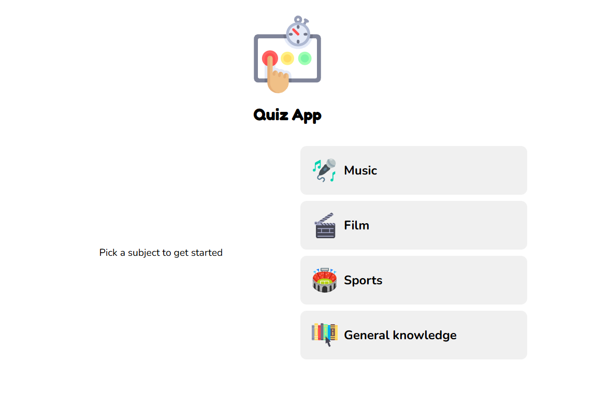
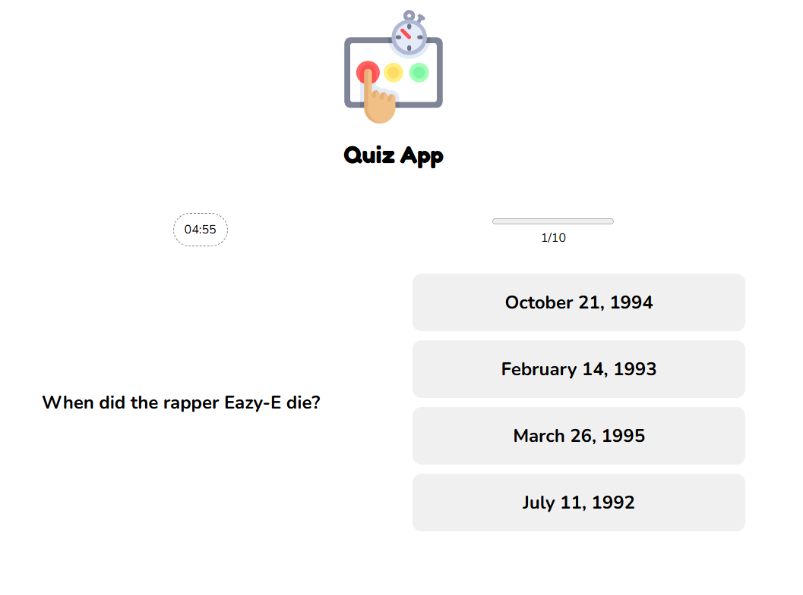
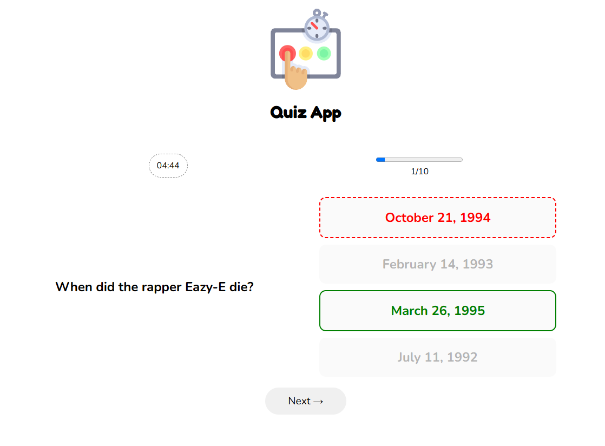
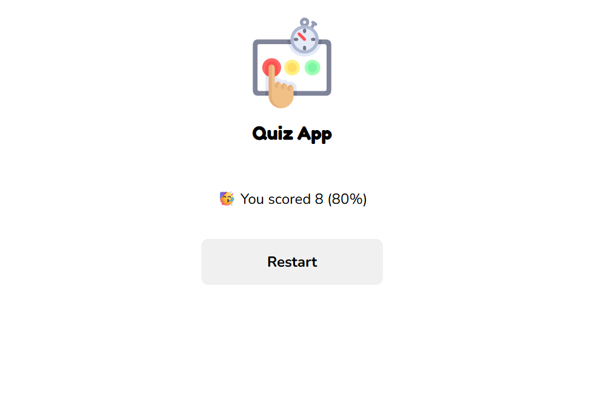
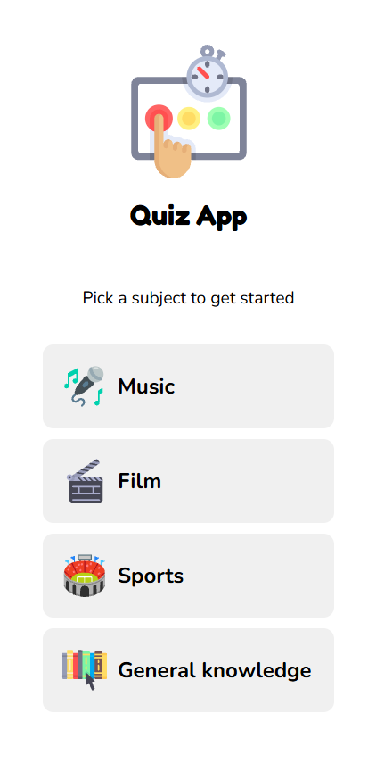
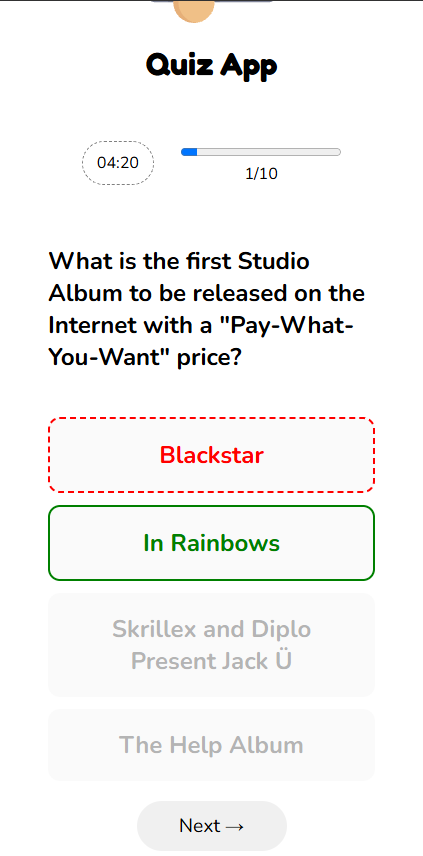
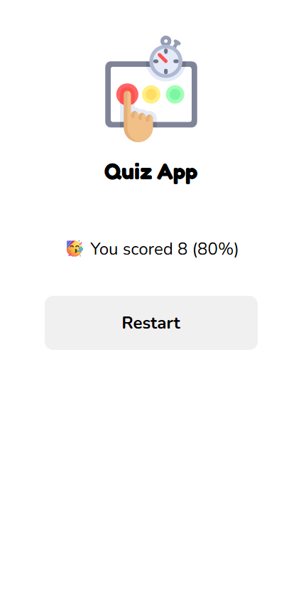

# Quiz App

An interactive quiz application built with React that allows users to test their knowledge across different subjects. Questions and answer options are fetched from the Open Trivia Database API. Users can track their progress, answer questions within a time limit, receive immediate feedback, and view their final score.

[Demo](https://melissa-mill.github.io/quiz-app/)

## Features
- Select a quiz subject
- Select a single answer from each question
- See if user has made a correct or incorrect choice after submitting an answer
- See a completed state with the score after the final question
- Play again to choose another subject

## Technologies
- React
- JavaScript
- CSS
- Vite
- Open Trivia Database API

## Screenshots

### Desktop

### Mobile

